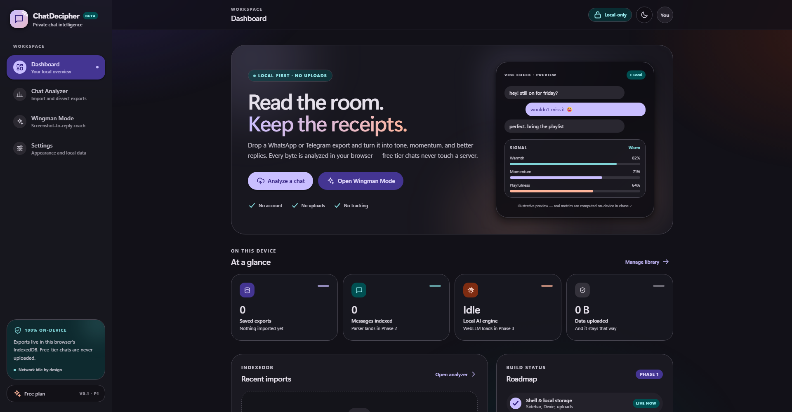
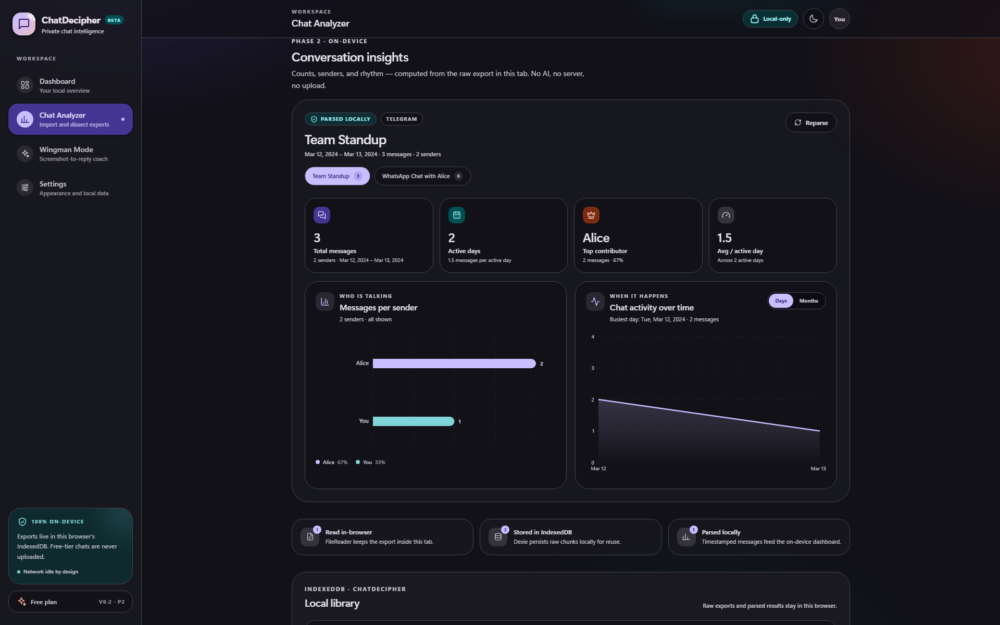
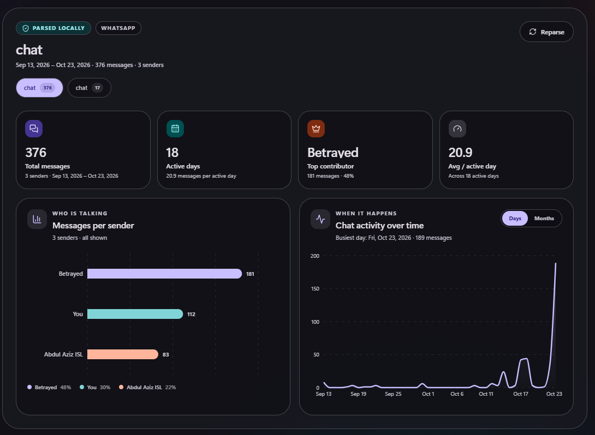

# ChatDecipher

A privacy-first, local-processing chat analyzer and Wingman app.

> **Status: Phase 2 of 5** — local WhatsApp/Telegram parsers, quantitative
> metrics, and a Recharts dashboard. Free-tier chat data never leaves the browser.



## Stack

| Layer | Choice |
| --- | --- |
| Framework | Next.js 16 (App Router, `output: "export"`) |
| Styling | Tailwind CSS 4 + Material 3 Expressive tokens |
| Local persistence | Dexie 4 (IndexedDB) |
| Charts | Recharts 3 |
| Icons | lucide-react + a built-in SVG set |
| Local AI (Phase 3) | `@mlc-ai/web-llm` in a Web Worker |
| Local OCR (Phase 4) | `tesseract.js` |
| Premium API (Phase 4/5) | Next.js API routes → Claude / GPT-4o |

## Commands

```bash
npm install
npm run dev        # http://localhost:3000
npm run typecheck
npm run build      # static export into ./out (+ RSC filename fix)
npm run preview    # serve ./out with `serve`
```

> **Windows static-export note:** Next 16.4 writes nested `__next.*` folders for
> RSC payloads on Windows, while the client router requests flat dotted names.
> `scripts/fix-static-export-rsc.mjs` runs after every build and flattens them.
> Upstream issue: [vercel/next.js#85374](https://github.com/vercel/next.js/issues/85374).
> The script is a no-op on Linux/macOS.

## What Phase 2 includes

- **WhatsApp `.txt` parser** (`src/lib/parsers/whatsapp.ts`) — handles the
  bracketed iOS shape (`[12/03/24, 9:41:05 PM] Alice: …`) and the Android shape
  (`12/03/24, 21:41 - Alice: …`), 12/24-hour clocks, `/`, `.`, and `-` date
  separators, multiline messages, system notices, and the invisible directional
  marks WhatsApp adds to exports.
- **Telegram `.json` normalizer** (`src/lib/parsers/telegram.ts`) — reads
  standard Telegram Desktop exports, flattens string/entity-array message text,
  uses `date_unixtime` when available, skips service and media-only rows, and
  adopts the export title as the contact name.
- **Quantitative metrics** (`src/lib/metrics.ts`) — total messages, counts by
  sender, top contributor, unique senders, active days, average messages per
  active day, and continuous daily/monthly activity series.
- **Automatic local queue** (`src/lib/process-chat.ts`) — the analyzer finds
  queued Dexie records, parses them on the main thread, persists metrics, and
  flips the record from `Queued` to `Parsed`. Failures become `Error` with a
  readable reason and a retry action. Nothing is uploaded.
- **Recharts dashboard** — total/active-day/top-contributor/average stat cards,
  a messages-per-sender bar chart, an activity-over-time area chart with
  day/month granularity, a multi-chat picker, and a manual reparse action.
- **M3 Expressive presentation** — tonal chart cards, theme-aware palettes,
  responsive 2-up/stacked layouts, accessible chart summaries, and a mobile
  layout with no horizontal overflow.



### A real export, parsed locally



The capture above is a 376-message WhatsApp export processed in the browser:
3 senders, 18 active days, 20.9 messages per active day, and a 189-message peak
on Oct 23, 2026. No message content or metrics left the device.

### Phase 1 foundations

- Desktop sidebar, sticky top bar, mobile bottom navigation, skip link.
- Material 3 Expressive tokens, 28–32px shapes, spring-ish motion, and
  light/dark/system themes. Theme lives in IndexedDB with a localStorage
  boot-time mirror.
- Drag/drop or browse for `.txt` / `.json`, 20 MB cap, multi-file validation,
  progress, and inline feedback.
- Local library with status badges, per-chat delete, clear-all confirmation, and
  a storage inspector in Settings.

## Parser notes

- **Ambiguous dates:** WhatsApp exports use the phone's locale. ChatDecipher
  scans the file for unambiguous dates (a value above 12) to choose day-first or
  month-first, then falls back to day-first. A file containing only ambiguous
  dates cannot be resolved with certainty without asking the user.
- **Message text:** continuation lines are joined back into the preceding
  message. Timestamped system notices are skipped rather than appended.
- **Media:** `<Media omitted>` rows count as messages; Telegram media-only rows
  without text are skipped. Exports should be generated without media.
- **Time zone:** metrics bucket days and months in the browser's local time zone,
  matching the way the export is read.
- **No AI in this phase:** there is no WebLLM, WebGPU, OCR, or cloud call in the
  Phase 2 pipeline.

## Privacy model

- Static export → no server rendering of user data, deployable anywhere.
- No analytics, no accounts, no network requests for chat content.
- Parsing and chart computation run entirely in the browser.
- The only optional network use in later phases is downloading model weights
  (Phase 3) and explicit, opt-in Pro generation on redacted text (Phase 4/5).

## Project layout

```
src/
  app/                 # routes: /, /analyzer, /wingman, /settings
  components/
    analyzer/          # dashboard + Recharts chart components
    layout/            # sidebar, top bar, mobile nav, shell
    settings/          # appearance, plan, data panels
    chat-dropzone.tsx  # export intake
    chat-library.tsx   # Dexie-backed local library + retry
    library-stats.tsx  # on-device counters
    theme-provider.tsx # theme context + persistence
  lib/
    db.ts              # Dexie schema + helpers
    chat-files.ts      # upload validation rules
    metrics.ts         # quantitative metrics
    process-chat.ts    # parse → metrics → persist pipeline
    parsers/
      whatsapp.ts      # regex parser for .txt exports
      telegram.ts      # normalizer for .json exports
      types.ts         # shared normalized message shape
    navigation.ts      # nav config
    styles.ts          # shared class recipes
scripts/
  fix-static-export-rsc.mjs  # Windows RSC path workaround
```

## Test checklist

1. `npm run dev`, open **Chat Analyzer**.
2. Import a WhatsApp `.txt` export without media. The library row should move
   from **Queued** to **Parsed**, and the dashboard should appear automatically.
3. Check the four stat cards against the conversation, then confirm the sender
   bars and activity area chart render.
4. Import a Telegram `.json` export. Its export title should become the chat
   name, and the chat picker should let you switch between imports.
5. Refresh the page: parsed metrics and charts should return without reparsing.
6. Import an invalid `.txt` to see an **Error** row with a retry action.
7. Toggle dark mode and resize to mobile width; charts should re-theme and stay
   inside the viewport.
8. With DevTools open, import a file and confirm no network request carries chat
   content.
9. Open **Settings → Data & privacy** and clear the library; dashboard counters
   should return to zero.

## Docs

- [Android packaging plan](docs/android-packaging.md) — PWA-first, TWA for the
  Play Store, with the WebGPU/WebView constraints and test matrix.
